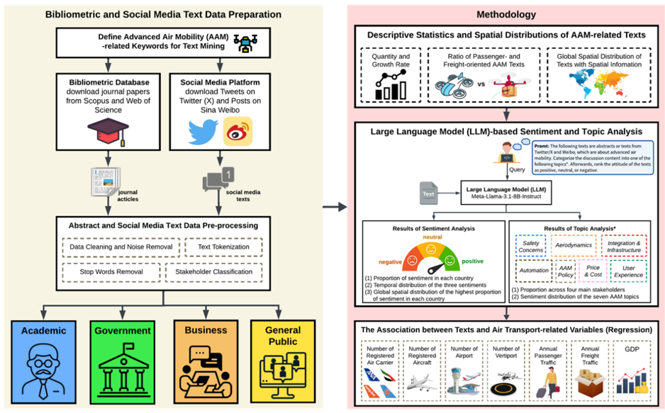

# Stakeholder attention to advanced air mobility reveals worldwide disparities

> Posted on 13 October 2026 by Ding Chen

Our study examines how academia, governments, businesses, and the general public discuss advanced air mobility (AAM) worldwide. Using approximately 300,000 bibliometric and social-media texts published between 2015 and 2024, we identify temporal, spatial, and thematic differences in stakeholder attention, sentiment, and priorities. The findings reveal substantial disparities in AAM discourse across regions and stakeholder groups, with implications for policy, infrastructure planning, commercial development, and public acceptance.

- First, AAM-related attention has increased across all stakeholder groups, particularly among governments, businesses, and the general public. The United States, China, United Kingdom and Germany account for much of the observed academic and online discussion.
- Second, governments and businesses place greater emphasis on AAM infrastructure and integration, including vertiports, airspace management, and operational readiness.
- Third, academia mainly focuses on aerodynamics and safety, while comparatively less attention is directed towards user experience, affordability, and policy questions.
- Fourth, the general public places greater emphasis on end-user experience, safety, and pricing. Concerns regarding affordability and high costs are especially prominent within negative public discussions.
- Fifth, AAM discussion is most concentrated in economically strong regions with established aviation systems, indicating that aviation capacity, economic resources, and transport demand are closely associated with global AAM attention.

This study provides new evidence on the coordination gaps between technical, institutional, commercial, and public priorities. It offers policy-relevant guidance for more coordinated AAM regulation, infrastructure investment, public engagement, and integration with existing urban and regional transport systems.

> *Research framewor*

> *Topic analysis of the AAM-related discussions. a, Temporal distribution of AAM-related topics across four stakeholders. b, Sentiment for topics across the government, business, and general public. c, Spatial distribution of CVs of AAM-related topics. d, The distribution of AAM-related topics across the ten countries with the highest volume of social media texts is illustrated in the radar chart.*