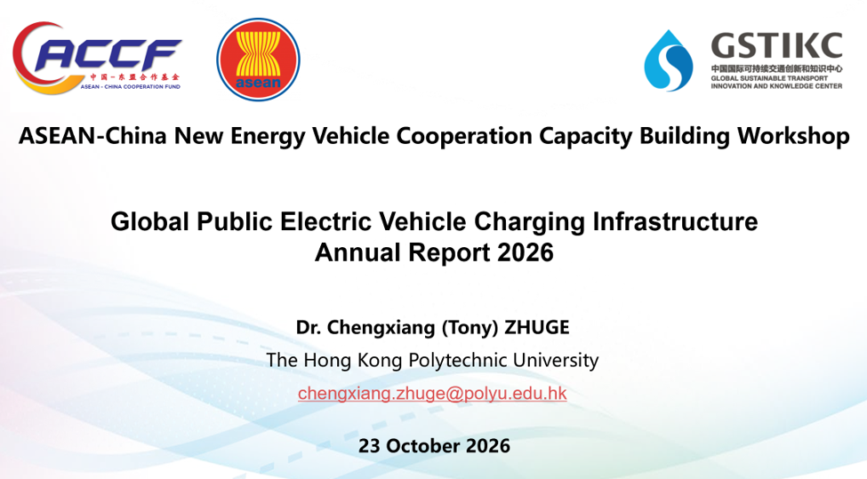
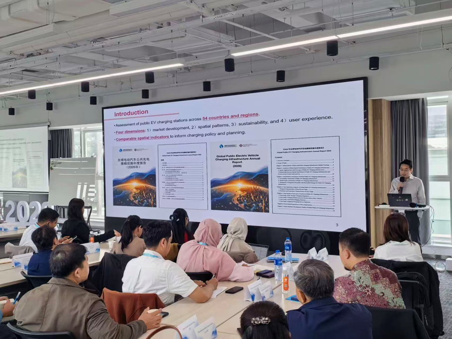

# Presentation on Global EV Report at the ASEAN-China New Energy Vehicle Cooperation Capacity Building Workshop 

> Posted on 13 November 2026 by Ding Chen

Dr. Chengxiang (Tony) Zhuge, Principal Investigator of the Global EV Data Initiative, was invited by the Global Sustainable Transport Innovation and Knowledge Center (GSTIKC) to speak at the ASEAN-China New Energy Vehicle Cooperation Capacity Building Workshop in Changzhou on 23 October 2026.

The workshop brought together representatives from the Association of Southeast Asian Nations (ASEAN) Secretariat, government departments across ASEAN Member States, and Chinese industry and research organisations to exchange insights on EV development, technology,  infrastructure and regional cooperation.

Dr. Zhuge shared findings from the forthcoming Global Public Electric Vehicle Charging Infrastructure Annual Report (2026) and discussed with experts from participating countries.

> *Presneation Title: Global Public Electric Vehicle Charging Infrastructure Annual Report 2026*

> *Dr. Tony Zhuge at ASEAN-China New Energy Vehicle Cooperation Capacity Building Workshop*
